# FolioVeil 用户指南

**第一次使用，先读第一部分；已经用过，直接查第二部分。**

FolioVeil 让你在一个独立的浏览器标签页中阅读本地 TXT、微信读书和番茄小说。阅读页采用 ChatGPT 风格的外观，章节标题显示在上方，正文显示在下方。你不需要输入问题，也不需要登录 ChatGPT；阅读内容不会发送给 ChatGPT 或其他 AI。

适用版本：**V1.0.0** · 更新日期：**2026-10-03** · 面向桌面版 Chrome / Microsoft Edge。

> **配图说明：** 文中截图使用当前版本的本地界面与自制示例内容。为避免暴露真实书籍、文件和账号信息，操作演示图在隔离的本地预览中拍摄；网站阅读的行为说明以当前功能和已完成的实测记录为依据。截图里的文字是示例，不是你的阅读记录。

## 第一部分｜第一次使用：先读起来

### 1. 找到 FolioVeil

安装后，点击浏览器工具栏的**扩展图标**，在列表中找到 **FolioVeil**。可以将它固定到工具栏，之后直接点击图标即可打开。

如果还没有安装，请先看[安装与更新](#installation)。本指南编写时，V1.0.0 正在准备商店发布，尚没有可提供的正式商店链接；请使用开发者提供的安装入口或扩展包。

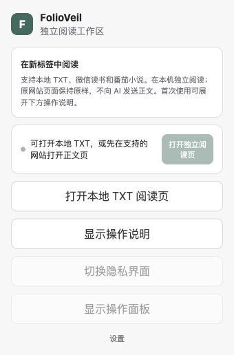

*图 1：打开 FolioVeil 后看到的入口。当前不在支持的网站正文页时，“打开独立阅读页”会变灰，TXT 入口仍可使用。*

### 2. 选择你要读的内容

想先试一下，可以下载并保存配套的[三章示例 TXT](example.txt)，再按下表打开。示例不包含真实书籍内容。

| 我要读什么 | 从哪里开始 | 打开后要做什么 |
| --- | --- | --- |
| 电脑上的 TXT 文件 | 弹窗 → **打开本地 TXT 阅读页** | 点击 **选择 TXT 文件**，选择一个 `.txt` 文件 |
| 微信读书 | 先在微信读书打开书籍正文，再点插件图标 → **打开独立阅读页** | 等待首次内容出现；建议先将微信读书设为单栏上下滚动模式 |
| 番茄小说 | 先在番茄小说打开某章正文，再点插件图标 → **打开独立阅读页** | 等待当前完整章节出现 |

**网站阅读时，请保留原网站标签页。** 它负责提供后续内容；阅读页负责展示。不要在读取过程中手动切章、换书或关闭来源标签。

首次安装或更新插件后，若原网站已经开着，先刷新那个标签，再打开 FolioVeil 阅读页。

### 3. 记住四个入口

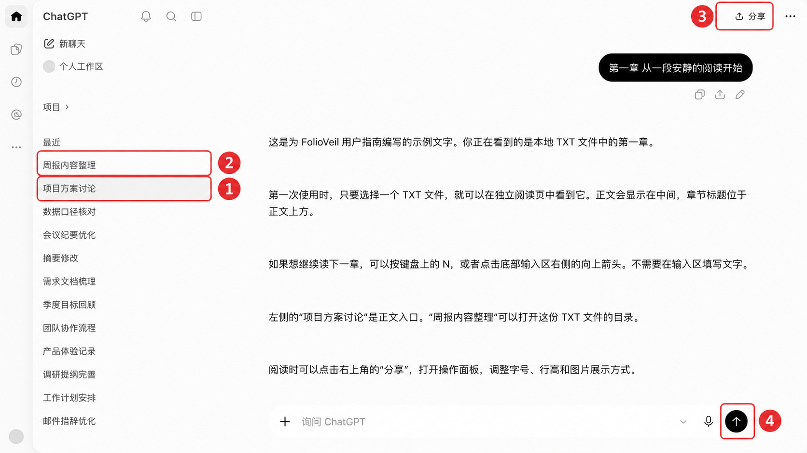

*图 2：按红框旁的编号找到四个入口：①回到正文，②打开 TXT 目录，③打开操作面板，④获取后续内容。红框与编号是指南标注，实际界面中不会显示。标题气泡是章节名，下方是文件正文。*

| 图中编号与页面名称 | 实际用途 | 你什么时候需要它 |
| --- | --- | --- |
| ① **项目方案讨论** | 正文入口 | 从目录或其他侧栏项目回到书籍正文 |
| ② **周报内容整理** | **仅 TXT 模式下**是目录 | 跳转到某章或回看之前的章节 |
| ③ 右上角 **分享** | 打开本地操作面板 | 调整阅读外观、看图方式、隐私或连接；这里不会发布或分享正文 |
| ④ 底部右侧 **↑ 向上箭头** | 获取后续内容 | 想读下一章或下一批时点击；也可以直接按 **N** |

**底部写着“询问 ChatGPT”，只是保留的界面外观。你不用输入文字，点击右侧箭头即可继续取内容。**

### 4. 继续读，或跳到想读的位置

- **想获取新的内容：** 点击底部 **↑**，或让焦点位于阅读页内，轻按一次 **N**。
- **只想往下看已经出现的正文：** 使用鼠标滚轮、触控板，或左右方向键。**方向键不会从网站取下一章。**
- **想跳到 TXT 的某一章：** 点击 **周报内容整理** → 选章节 → 点击 **返回阅读** 或 **项目方案讨论**。

读取过程中按钮会暂时变灰。等它恢复后再操作；连续点击或长按 N 不会排队读取很多章。

### 5. 调整显示，或暂时遮挡

点击右上角 **分享** 打开操作面板。展开 **排版与外观**，可以调整字号、行距、宽度和主题。

需要临时遮挡时，在面板里点击 **快速隐私**。回来后，再点 **分享 → 继续**。仅仅切回标签页，不会自动恢复被遮挡的正文。

**到这里，你已经能完成一次日常阅读。** 遇到特定问题时，按下面的目录查阅即可。

## 第二部分｜详细说明：按功能查阅

| 你想做什么 | 查看这里 |
| --- | --- |
| 安装、固定图标、更新后重新打开 | [安装与更新](#installation) |
| 搞清楚弹窗中每个按钮 | [扩展弹窗](#popup) |
| 找到正文、目录、发送按钮和侧栏 | [阅读页按钮地图](#interface) |
| 下一章、往回看、等待、到达末尾 | [如何继续阅读](#navigation) |
| TXT 目录、续读、换文件、乱码 | [本地 TXT](#txt) |
| 微信读书单栏、双栏、切换模式 | [微信读书](#weread) |
| 番茄小说完整章节与试读停止 | [番茄小说](#fanqie) |
| 隐藏图片、缩略图、全图、放大预览 | [图片阅读](#images) |
| 面板各按钮、来源信息、返回原站 | [操作面板](#controls) |
| 字号、主题、语言、热区和设置保存 | [显示与交互设置](#settings) |
| 快捷键用法与失效原因 | [快捷键速查](#shortcuts) |
| 遮挡、恢复、保存数据与隐私范围 | [隐私与本地数据](#privacy) |
| 断开、冻结、重连、部分读取 | [故障速查与连接恢复](#troubleshooting) |
| 导出诊断、重置、反馈问题 | [维护与反馈](#maintenance) |
| 当前版本能做什么、哪些还有限制 | [支持范围](#limits) |

### 1. 安装与更新

#### 1.1 安装前准备

使用电脑上的 Chrome 或 Microsoft Edge。本指南不适用于手机浏览器。

- **读 TXT：** 准备电脑上的 `.txt` 文件，不需要网站账号。
- **读网站：** 确保你能在原网站正常打开并阅读该章；需要登录或取得阅读权限的步骤仍在原网站完成。
- **不需要 ChatGPT 账号或 AI API Key。**

Chrome 与 Edge 都有已完成的部分使用验证；微信读书登录后的连续读取主要在 Edge 验证。不同浏览器和来源状态仍可能有差异，遇到问题可按[故障速查](#troubleshooting)处理。

#### 1.2 如果开发者给你的是商店链接

正式商店入口发布后，打开开发者提供的 FolioVeil 商店详情页，核对名称和发布者，按浏览器提示添加扩展。浏览器可能要求确认扩展权限。安装界面的通用操作可参考 [Chrome 官方帮助](https://support.google.com/chrome/answer/2664769?hl=zh-Hans)和 [Edge 官方帮助](https://support.microsoft.com/zh-CN/edge/add-turn-off-or-remove-extensions-in-microsoft-edge)。

**截至本指南更新日，尚未提供正式上架链接。不要把本指南中的“V1.0.0”理解为已经通过商店审核。**

#### 1.3 如果开发者给你的是解压缩扩展包

1. 将扩展包解压到一个准备长期保留的文件夹。
2. 在浏览器地址栏输入 `chrome://extensions`（Chrome）或 `edge://extensions`（Edge）。
3. 打开 **开发者模式／开发人员模式**。
4. 点击 **加载已解压的扩展程序／加载解压缩的扩展**。
5. 选择**直接包含 `manifest.json` 的那一层文件夹**，不是 ZIP 文件本身，也不是外层总目录。
6. 确认扩展列表中出现 FolioVeil，且开关已启用。

这种安装方式依赖本机文件夹，之后不要随意移动或删除它。Edge 的同类操作也可参考[官方本地安装说明](https://learn.microsoft.com/zh-cn/microsoft-edge/extensions/getting-started/extension-sideloading)。如果浏览器由单位管理且不允许加载扩展，请联系管理员。

#### 1.4 把图标固定到工具栏

点击浏览器的 **扩展** 图标，在 FolioVeil 旁选择**固定到工具栏**或相应的图钉按钮。以后点击 FolioVeil 图标，就能看到图 1 的弹窗。

#### 1.5 更新后为什么还要刷新

插件更新后，之前打开的网站和阅读页可能仍在使用旧状态。按以下顺序处理：

1. 确认扩展已完成更新；手动加载版需要在扩展管理页点击 **重新加载**。
2. 切到微信读书或番茄小说的来源标签，刷新并等待正文出现。
3. 关闭旧阅读页，从来源标签的扩展弹窗重新打开。
4. TXT 阅读页更新或刷新后，需要重新选择文件；有可用位置时再选择 **继续阅读**。

刷新网站阅读页会从来源当前位置重新读取，不保证恢复此前所有已显示章节。

#### 1.6 安装时的权限提示怎么看

| 提示涉及的权限 | FolioVeil 当前用它做什么 |
| --- | --- |
| 在本机存储数据 | 保存显示设置、少量 TXT 续读位置和本地诊断 |
| 访问微信读书、番茄小说及相关图片资源 | 从支持的正文页取得内容，并读取可用的图片 |
| 调试浏览器相关权限 | 微信读书连续读取时，向绑定的来源页执行必要的翻页操作 |

这些权限不要求你把网站密码填进插件。网站登录仍在原网站进行；FolioVeil 不提供账号登录表单，也不要求 AI 密钥。关闭来源后已展示内容是否保留，以及遮挡范围，请看[隐私与本地数据](#privacy)。

### 2. 扩展弹窗：每个按钮是做什么的

**打开方式：浏览器工具栏 → FolioVeil 图标。** 弹窗中的按钮会根据当前标签页变化。

| 按钮或区域 | 怎么用 | 点下去会怎样／为什么会变灰 |
| --- | --- | --- |
| 状态说明 | 先看这里是否识别到微信读书或番茄小说 | 识别到网站并不代表已读到正文；仍需在具体章节页面 |
| **打开独立阅读页** | 在支持的网站正文页点击 | 创建或打开对应的独立阅读页，并开始首次读取；在普通网页上不可用 |
| **当前已在独立阅读页** | 网站阅读页里可能显示这个名称 | 表示你已经在阅读标签中，无需再次创建 |
| **打开本地 TXT 阅读页** | 在任意标签点击 | 打开一个用于选择本地 TXT 的阅读页 |
| **显示操作说明／收起操作说明** | 点击展开或收起 | 显示 TXT、网站阅读、继续读取和目录入口的简短说明 |
| **切换隐私界面** | 当前为可控制的网站阅读页时使用 | 在阅读和遮挡状态之间切换；TXT 模式下目前可能不可用 |
| **显示操作面板** | 当前为可控制的网站阅读页时使用 | 唤出阅读页操作面板；TXT 请优先使用阅读页右上角的 **分享** |
| **设置** | 点击打开设置页 | 修改外观、交互和隐私偏好，查看快捷键，导出诊断或重置 |
| **连接到已断开的阅读页** | 出现此区域时，从列表选择旧阅读页 | 只有选定目标后，**连接所选阅读页**才可点击；详见[更换来源后重连](#reconnect) |

**网站阅读按钮变灰时，先确认当前标签。** 你可能停留在普通网页、扩展设置页或 TXT 阅读页。回到支持网站的具体正文页，再打开弹窗。

### 3. 阅读页按钮地图

#### 3.1 左侧：正文与目录

- **项目方案讨论：** 你的正文入口。如果你改过“阅读入口名称”，请点击改名后的那一项。
- **周报内容整理：** TXT 文件成功导入后，用它打开目录。网站阅读时它只是中性展示项，不是微信读书或番茄小说的整书目录。
- **切换侧边栏：** 侧栏顶部的切换按钮可收起或展开侧栏。侧栏收起后，再点页面左上方对应按钮即可找回。
- **其他侧栏项目、新聊天：** 用于切换到本地中性展示内容。它们不是你实际的聊天记录或书架；要回书籍正文，点击阅读入口。

如果已经进入隐私状态，点击阅读入口也不会自动解除遮挡，需要[明确继续](#privacy)。

#### 3.2 右上角：“分享”是操作面板入口

**请点页面最右上方的“分享”。** 它打开 FolioVeil 的本地操作面板，不会生成分享链接，不会上传正文。

正文附近也可能保留类似的图标。需要阅读设置时，请认准**页面右上角**这个入口。

#### 3.3 右下角：向上箭头是“获取后续内容”

**点击黑色圆形按钮中的 ↑，即可获取后续内容。** 鼠标放上去时，可能看到“获取后续内容（N）”提示。

- 不需要先输入任何文字。
- 输入区的加号不是 TXT 导入入口；TXT 应从扩展弹窗或操作面板选文件。
- 这个页面不提供 AI 对话、语音输入、朗读、模型选择或真实 ChatGPT 账户操作。其他保留的 ChatGPT 外观图标不应当作这些功能的入口。

### 4. 如何继续阅读

#### 4.1 “往下看”和“取新内容”有区别

| 你的目的 | 操作 | 结果 |
| --- | --- | --- |
| 看已经显示的下一部分 | 滚轮、触控板或 **→** | 在当前已加载正文里向下移动 |
| 回看已经显示的上一部分 | 向上滚动或 **←** | 在当前已加载正文里向上移动 |
| 获取下一章／下一批 | **N** 或底部 **↑** | 请求新的内容 |
| 回看 TXT 之前的章节 | **周报内容整理 → 选章节 → 返回阅读** | 切换到所选章节 |
| 回到网站中的另一章 | 回到原网站选择章节，再重新打开阅读会话 | 从新的来源位置开始；不会自动找回旧阅读页全部历史 |

左右方向键每次移动一个带少量重叠的可视区域。操作面板中的 **上一段／下一段**也用于移动当前已显示正文，不是网站上一章／下一章按钮。

#### 4.2 一次“获取后续内容”会读多少

| 内容来源 | 一次获取的含义 | 之前的内容如何显示 |
| --- | --- | --- |
| TXT | 下一章；不能可靠识别章节时是下一节 | 正文区域切换到新章／节；旧章可通过目录回看 |
| 微信读书单栏 | 首次当前章，以后每次下一章 | 按顺序继续追加 |
| 微信读书双栏 | 一批内容，正常情况下包含连续多次向后翻页，最多十次 | 按顺序追加；可能跨越多个章节 |
| 番茄小说 | 首次当前完整章，以后每次下一完整章 | 按顺序继续追加 |

你不需要数来源页翻了多少次。以阅读页的内容与提示为准。

#### 4.3 正在读取时

底部会出现 **正在获取后续内容，请稍候…**，获取按钮暂时禁用。

- 等待本次读取结束后，再主动获取下一次。
- 重复按 N、长按 N 或反复点击按钮，都不会排队创建多个请求。
- 提示“仍在等待”不代表可以再发一次请求。若来源休眠，先切到来源等待正文恢复，再按阅读页提示处理。
- 末尾、断开或结果无法确认时，按钮也会禁用。请先看正文末尾或操作面板的状态说明。

### 5. 本地 TXT：目录、续读和乱码

#### 5.1 打开文件

1. 点击插件图标 → **打开本地 TXT 阅读页**。
2. 在阅读页点击 **选择 TXT 文件**。
3. 从电脑选择一个 `.txt` 文件并打开。
4. 等待第一章显示；若出现续读提示，选择继续或从头开始。

文件只在本机读取。这一入口不支持直接导入 PDF、EPUB 或 Word 文件，也不需要将 TXT 上传到网站。

#### 5.2 目录与跳章

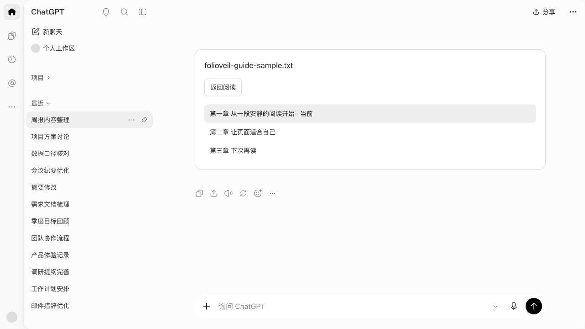

*图 3：选择章节后，可以点击“返回阅读”回正文。目录顶部会显示本次文件名，请避免在分享目录截图时带出私人文件名。*

1. 点击左侧 **周报内容整理**。
2. 找到想读的章节，点击章节名称。
3. 点击 **返回阅读**，或左侧的正文入口。

目录会标记当前章节。想回到上一章，也用这份目录；左方向键只在已显示的正文内移动。

TXT 会尽量识别“第一章”“Chapter 1”等标题。没有可靠章节标题时，按约 3000 字符分成“第 1 节、第 2 节……”；分节不表示原文件缺失了章节。

#### 5.3 下次打开，继续读到哪里

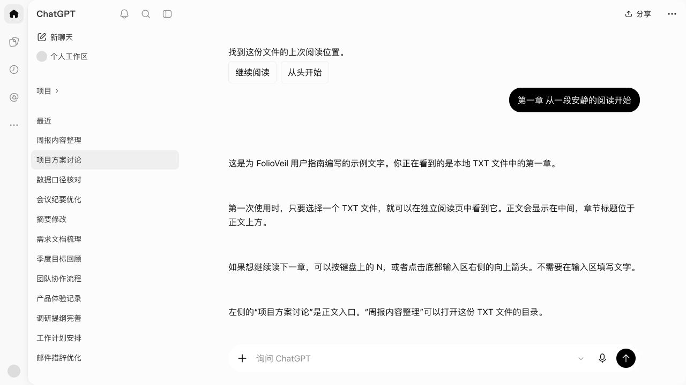

*图 4：“继续阅读”从上次章节或分节开头开始；“从头开始”回到第一章或第一节。*

关闭或刷新阅读页后，下次仍需重新选择同一个 TXT 文件。存在有效位置时，会显示：

- **继续阅读：** 回到上次打开的章节／分节开头。
- **从头开始：** 回到第一章／第一节。

**不会精确恢复到上次读过的某一行。** 插件不保存文件正文、文件名或文件路径，也不会把它作为书架里的书自动重新打开。

文件内容、使用的编码或分章方式发生变化时，旧位置可能不再适用。在其他电脑、其他浏览器或另一个浏览器用户配置中，也不会自动同步这份续读记录。

#### 5.4 换一本 TXT

在阅读页点击 **分享 → 选择 TXT 文件**，选择新文件。正常读入后，正文和目录切换到新文件。

同一面板内的 **重新连接**和 **恢复原页面**在当前 TXT 模式下也会打开文件选择器。为了避免混淆，日常换文件请使用名称明确的 **选择 TXT 文件**。

取消文件选择不会主动换书。文件无法读取时，先看错误提示，再尝试编码或重新选文件。

#### 5.5 出现乱码怎么办

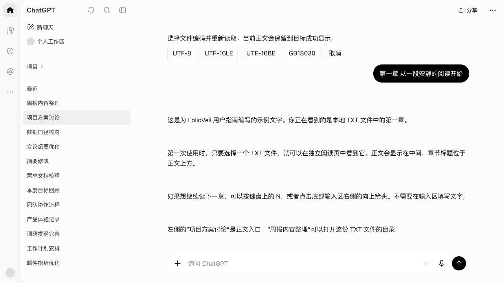

*图 5：编码按钮位于正文上方。改变编码会重新读取这个文件，不会修改你电脑上的原文件。*

1. 点 **分享 → 重新选择编码**。
2. 如果知道文件编码，选择对应按钮：**UTF-8、UTF-16LE、UTF-16BE、GB18030**。
3. 如果不知道，先试 UTF-8；较早的中文文本可再试 GB18030。
4. 若再次出现续读提示，作出选择后检查正文是否正常。
5. 想退出编码选择，点击 **取消**。

插件会自动尝试常见编码；出现“编码自动判断可能不准确”时，不一定已经乱码，先看正文。若文件提示没有可阅读文字，请确认文件非空且确实是纯文本，不是仅将其他格式改成 `.txt` 后缀。

### 6. 微信读书

#### 6.1 从当前章节开始

1. 在微信读书网页中打开一本书，进入你想读的章节。
2. 等待正文实际出现；不要停留在首页、搜索结果或书籍介绍页。
3. 在这个标签点击 FolioVeil 图标 → **打开独立阅读页**。
4. 首次内容出现后，在独立阅读页继续看；需要新内容时按 **N** 或点底部 **↑**。

首次读取会使用来源当前位置，可能推动原网站继续向后阅读。整个过程需要保留来源标签并保持其可用。

#### 6.2 建议使用单栏上下滚动

单栏模式下，第一次取得当前章，后续每次取得下一章，操作更容易理解。

如果使用双栏翻页模式，阅读页启动时可能在正文前显示一条单栏建议。它是使用提示，不是报错，也不会阻止读取。双栏下，一次获取可能翻过多页并跨章，不等于你误点了多次。

**切换为单栏的步骤：**

1. 回到微信读书原网站标签。
2. 点击原站右侧工具栏的阅读模式切换按钮，切换到**上下滚动阅读**。
3. 刷新微信读书页面，等待正文出现。
4. 关闭旧的 FolioVeil 阅读页。
5. 从来源标签的扩展弹窗重新打开阅读页。

不要仅切换原站布局后，继续在旧阅读页反复点击获取。来源布局改变后需要重新开始连接。

#### 6.3 原网站与独立阅读页的分工

- **原网站：** 登录、阅读权限、选书、选章和阅读模式切换。
- **FolioVeil 阅读页：** 展示已取得的内容、请求后续内容、排版、看图和隐私遮挡。

当前没有在 FolioVeil 中提供微信读书的整书目录，也没有网站书籍的本机续读记录。想从另一章重新开始，回原站选章，再重新打开阅读会话。

双栏含图章节的连续读取仍可能中途停止。遇到这种情况，先检查原站正文和当前位置；适合时改用单栏，并按上面的步骤重新打开。不要把已显示一批内容理解为整本书已经下载完成。

### 7. 番茄小说

1. 在番茄小说网页中打开具体章节，确认正文正常显示。
2. 点击 FolioVeil 图标 → **打开独立阅读页**。
3. 当前完整章节显示后，按 **N** 或点 **↑** 获取下一章。

取得的新章会追加在之前的内容后面。左侧 **周报内容整理**不提供番茄小说整书目录。

如果原站仅提供试读片段，插件会提示 **来源只开放本章试读片段，已在这里停止读取。** 此前已完整取得的章节仍可阅读；插件不会补全未提供的正文，也不会绕过原网站阅读限制。

如果提示来源字体变化或无法确认正文，请回原站核对，停止反复请求。当前完整性检查可能拒绝无法可靠识别的章节。

### 8. 图片阅读：隐藏、小图或临时放大

**入口：阅读页右上角 分享 → 图片展示。** 也可在扩展的 **设置 → 图片展示**修改。

微信读书中成功取得的图片可以使用下面的显示方式；TXT 本身是纯文本，不会因为打开图片模式就出现插图。图片示例图用于说明显示方式，不代表所有来源、所有图片都能成功取得。

| 选项 | 页面上看到什么 | 想看细节时怎么办 |
| --- | --- | --- |
| **禁止展示图片** | 保留“【图 1 · 点击查看】”一类文字入口，不自动显示图片 | 点击文字入口临时查看 |
| **展示缩略图** | 在正文中显示小图 | 点击小图打开临时预览 |
| **全图展示** | 在正文中直接显示图片 | 仍可点击查看；全图模式并不保证原尺寸或铺满正文宽度 |

看下面三张图时，请留意红框内的区域：隐藏模式只有文字入口，缩略图模式会显示小图；这份示例的全图模式中，图片略大，还显示了完整图注。红框、编号和红字是指南标注，实际界面中不会显示。

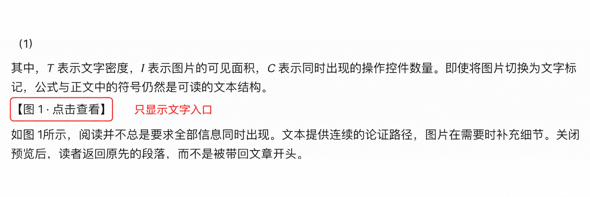

*图 6：看红框中的“【图 1 · 点击查看】”——这里没有自动显示图片，但可以点击文字临时查看。选择“禁止展示图片”不等于彻底禁止点开图片。*

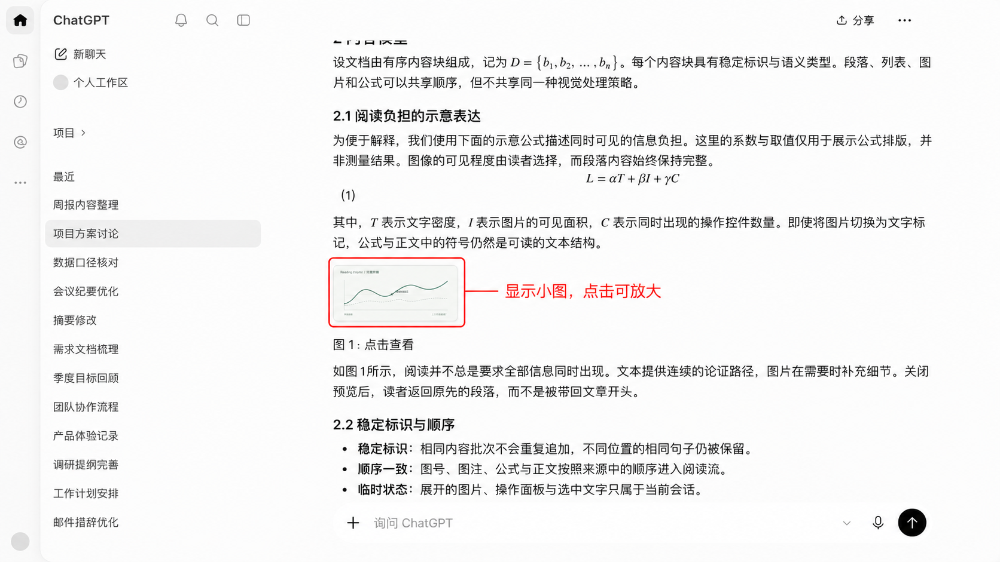

*图 7：看红框中的小图——图片已经显示在正文原来的位置，点击小图可打开临时预览。这份示例在小图下方保留点击入口，没有展开图 8 中那段完整图注。*

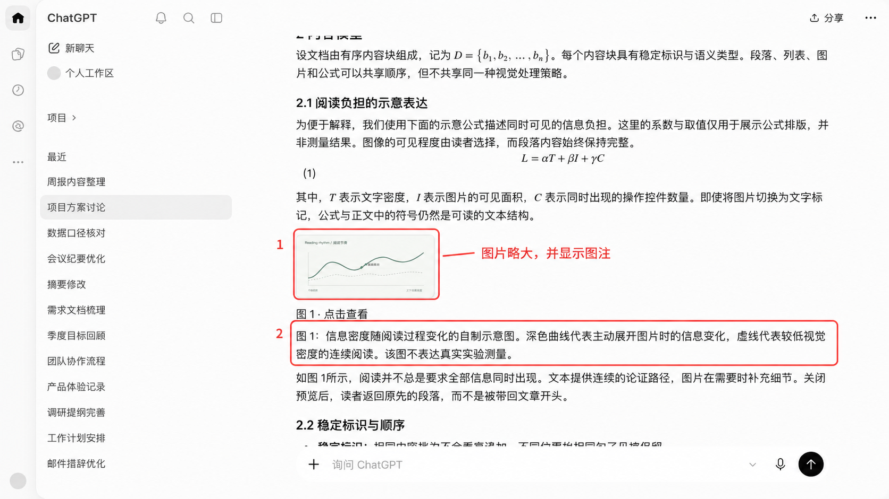

*图 8：对照图 7，红框 1 中的图片略大，红框 2 中多了一段完整图注。当前阅读外观仍限制图片尺寸，因此“全图展示”不一定比缩略图大很多，也不保证铺满正文。想看细节时，请点击图片打开临时预览。*

#### 临时查看与关闭

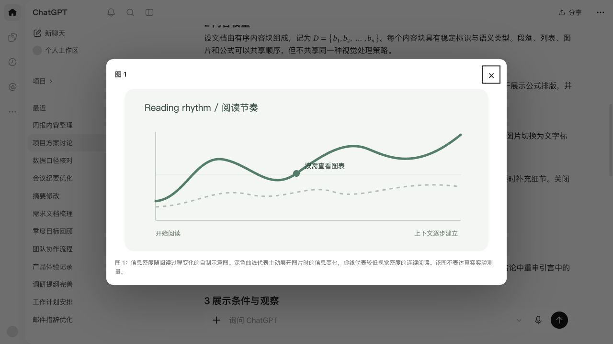

*图 9：临时预览显示图片和可用图注，右上角 × 用于关闭。*

点击图片或文字标记后，会打开预览。点击 **×**、按 **Esc**，或点击预览外的遮罩区域关闭，回到原来的阅读位置。临时查看不会把默认图片模式改成全图。

显示“暂时无法显示”时，可以点击标记或 **重试**。如果一直失败，回到原网站核对该图；不要将缺图理解为原文没有图片。

**隐藏图片只影响 FolioVeil 阅读页的自动显示。** 原网站可能已加载图片，插件也可能已在本机会话中取得资源，因此它不等于禁止所有图片网络请求。

### 9. 操作面板：阅读时就地调整

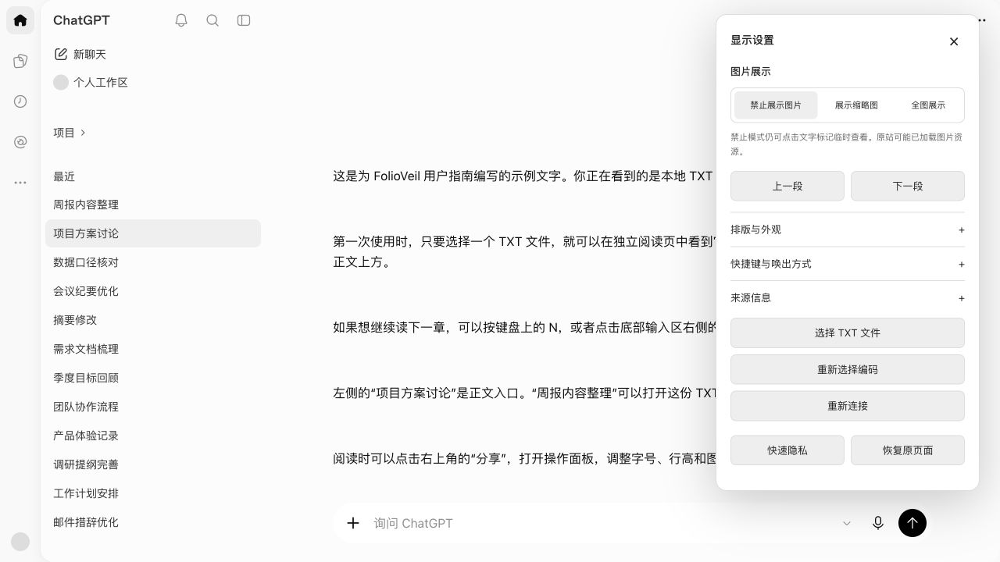

*图 10：TXT 的操作面板。网站模式的底部操作会有所不同，以实际显示为准。*

#### 9.1 如何打开和关闭

最直接的方法是点阅读页右上角 **分享**。另外也可以：

- 将鼠标停在阅读页面的指定角落。默认是**右上角，停留约 0.5 秒**；不是浏览器工具栏的角落。
- 使用操作面板快捷键；TXT 的组合快捷键目前有限制，见[快捷键速查](#shortcuts)。

关闭时点右上角 **×** 或按 **Esc**。点击面板外也可收起。鼠标离开后可能按设置的延迟自动收起；正在编辑面板字段时不会按同样方式立即打断。

#### 9.2 各项功能

| 面板项目 | 作用及使用方法 |
| --- | --- |
| **图片展示** | 三个按钮选一种显示方式，见[图片阅读](#images) |
| **上一段／下一段** | 移动当前已经显示的正文；需要新内容时用底部 **↑** 或 **N** |
| **排版与外观** | 点击这一行展开；调整字号、行距、正文宽度、主题、侧栏及会话显示名称 |
| **快捷键与唤出方式** | 点击展开；调整鼠标热区、停留时间、收起延迟、失焦自动遮挡和左右键导航 |
| **来源信息** | 点击展开查看当前内容来源；可能包含真实名称或网站地址，截图分享前留意这一处 |
| **内容目录**（若显示） | 定位当前已载入内容中的标题，不代表网站整书目录；TXT 整个文件的目录仍在左侧 **周报内容整理** |
| **选择 TXT 文件** | TXT 模式换文件或重新选择文件 |
| **重新选择编码** | TXT 模式重新解码当前文件；未选文件时没有可重读内容 |
| **重新连接** | 网站模式下用于页面明确允许重试的连接状态；不能修复所有异常。TXT 模式下会打开文件选择器 |
| **刷新来源** | 网站模式下刷新关联的来源标签；来源恢复后还需要按提示刷新阅读页 |
| **快速隐私／继续** | 遮挡正文，或明确恢复阅读 |
| **恢复原页面** | 网站模式下切回来源标签，同时让独立阅读页进入隐私；TXT 模式下打开文件选择器 |
| **返回原阅读页**（部分状态显示） | 回到原网站检查，不是回到 TXT 上一章 |

**“重新连接”不是“撤销”“恢复整本书”或“恢复全部历史”。** 如果页面要求刷新，请按提示顺序处理。

### 10. 显示与交互设置

**完整设置入口：插件图标 → 设置。** 阅读时常用的部分设置也可以从操作面板修改。

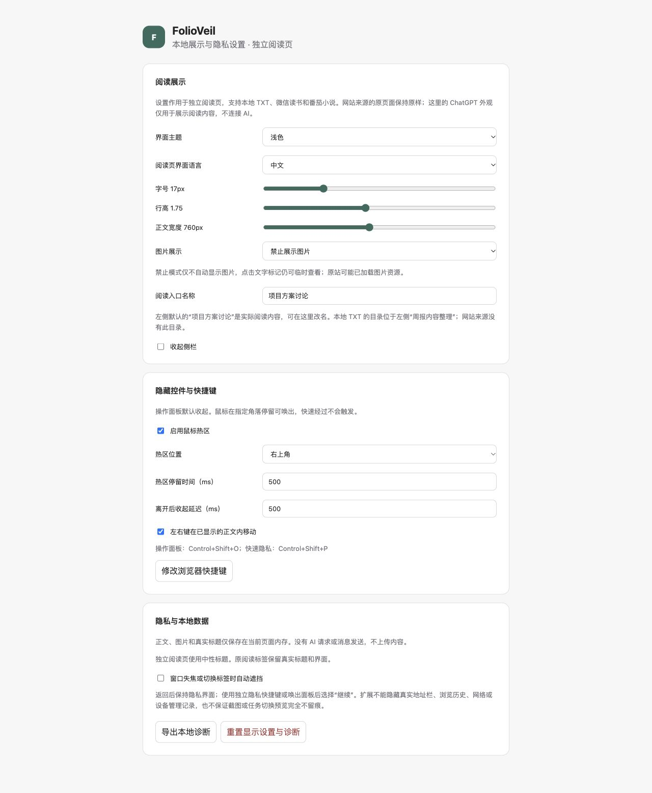

*图 11：完整设置页。改动自动保存，不需要寻找“保存”按钮。图中数值为演示状态，已有用户的保存值可能不同。*

#### 10.1 让文字读起来舒服

| 设置项 | 能改变什么 | 使用建议 |
| --- | --- | --- |
| **界面主题** | 浅色、深色或跟随系统 | 按环境和个人习惯选择 |
| **阅读页界面语言** | 中文或 English 的阅读页展示文字 | 不会翻译书籍正文；部分本地操作提示仍可能显示中文 |
| **字号** | 阅读正文的字大小，可调 14–26 px | 看字费力时先增大字号 |
| **行高／行距** | 每行之间的距离，可调 1.4–2.2 | 感觉拥挤时适当增大 |
| **正文宽度** | 正文排版宽度，可调 560–1000 px | 行太长、回行困难时缩窄；实际效果受窗口和原外观布局限制 |
| **图片展示** | 隐藏、缩略图、全图 | 默认不自动展示图片，可按需更改 |
| **阅读入口名称** | 左侧正文入口及阅读标签的中性名称 | 修改后，找新名称返回正文；操作面板中叫 **会话显示名称** |
| **收起侧栏** | 隐藏或展开左侧会话区域 | 需要目录时再展开 |

文字设置用于阅读内容，不会改变微信读书或番茄小说原网站的排版。网站单栏／双栏模式仍需在原网站调整。

#### 10.2 鼠标热区和操作习惯

| 设置项 | 作用 |
| --- | --- |
| **启用鼠标热区／鼠标热区唤出** | 允许鼠标在指定角落停留后打开面板；关掉后仍可点 **分享** |
| **热区位置** | 在阅读页四个角中选一个 |
| **热区停留时间** | 停多久才出现面板；经常误触时可调长 |
| **离开后收起延迟** | 鼠标移出多久后收起；操作来不及时可调长 |
| **左右键在已显示的正文内移动／左右键导航** | 开关阅读页的方向键移动行为 |
| **窗口失焦或切换标签时自动遮挡／失焦自动遮挡** | 离开阅读页后遮挡正文；默认关闭，已有保存选择会继续生效 |
| **修改浏览器快捷键** | 打开浏览器的扩展快捷键管理页，查看或改键 |

热区快速经过不会立刻弹出面板。拖选正文、图片预览等状态下，它也可能暂时不触发。遇到这种情况，先结束当前操作，再点 **分享**。

#### 10.3 保存与同步

设置会自动保存在当前浏览器的本地配置中，并同步到该配置内已打开的 FolioVeil 阅读页。它不提供跨电脑、跨浏览器的账户同步。

设置修改后没有生效时，先确认你操作的是同一个浏览器配置中的 FolioVeil；必要时重新打开阅读页。不同浏览器的独立安装不会共用设置。

### 11. 快捷键速查

| 操作 | Windows 等系统的建议默认键 | macOS 的建议默认键 | 适用条件 |
| --- | --- | --- | --- |
| 获取后续内容 | **N** | **N** | 正文阅读状态，且没有进行输入或其他受保护操作 |
| 已显示正文向前／向后移动 | **←／→** | **←／→** | 开启方向键导航，焦点在阅读页面内 |
| 打开／关闭操作面板 | **Alt + Shift + O** | **Control + Shift + O** | 实际注册键以浏览器管理页为准；TXT 有已知限制 |
| 切换隐私界面 | **Alt + Shift + P** | **Control + Shift + P** | 网站阅读页；TXT 有已知限制 |
| 关闭面板或图片预览 | **Esc** | **Esc** | 对应浮层已经打开；不是退出隐私的快捷键 |

macOS 这里使用 **Control**，不是 Command。

**N 没反应时，依次检查：**

1. 点击正文空白处，让焦点回到阅读页。
2. 关闭操作面板和图片预览，结束文字输入或输入法组字，取消已选中的文字。
3. 确认已经退出隐私状态，并回到正文入口。
4. 看看是否仍在读取，或已到末尾／连接断开。
5. 松开 N 后再按一次；不要同时按其他修饰键。

**TXT 当前的已知限制：** 面板／隐私组合快捷键及弹窗控制可能没有响应。请使用 **分享 → 操作面板**，再点 **快速隐私／继续**；获取下一章仍可用 **N** 或底部 **↑**。

### 12. 隐私与本地数据

#### 12.1 临时遮挡与恢复

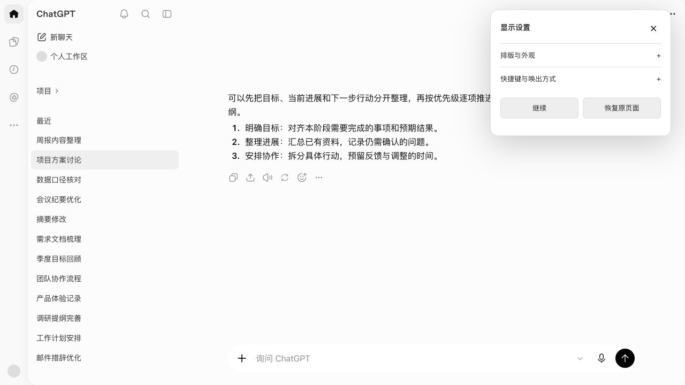

*图 12：正文被中性内容替换后，打开操作面板点击“继续”即可恢复。*

**手动遮挡：** 阅读页 **分享 → 快速隐私**。

**恢复阅读：** 阅读页 **分享 → 继续**。网站阅读页也可使用已注册的隐私快捷键。

隐私状态会隐藏真实阅读正文、图片和实际目录等内容，并关闭临时图片预览。仅切换标签、打开设置、关闭操作面板或点击其他会话，不会自动解除隐私。

#### 12.2 离开时自动遮挡

到 **设置 → 窗口失焦或切换标签时自动遮挡**，勾选即可开启。也可以在面板的 **快捷键与唤出方式**中开启 **失焦自动遮挡**。

启用后，切到别的标签页或应用，再返回时仍显示中性内容，需要明确继续。首次使用默认关闭；若你以前开启过，插件会保留选择。

#### 12.3 哪些会保存

| 内容 | 当前行为 |
| --- | --- |
| 阅读正文、图片与真实标题 | 在当前页面／阅读会话内存中使用，不作为可长期打开的书架保存 |
| TXT 续读位置 | 在本机保存少量定位信息；不保存 TXT 正文、文件名或路径 |
| 显示和交互设置 | 保存在当前浏览器本地 |
| 本地诊断 | 记录经过限制的诊断事件，可手动导出 |
| AI 消息 | 不会向真实 ChatGPT 或其他 AI 提交阅读内容 |

**遮挡不等于清除。** 隐藏期间会保留用于继续阅读的内存内容。网站来源关闭或断开后，阅读页也可能仍保留已经展示的正文；不要把关闭来源标签当作已清空阅读内容。如果结束本次阅读，请关闭独立阅读页。

#### 12.4 哪些不会被隐藏

FolioVeil 的遮挡针对独立阅读页。它不能隐藏或清除：

- 原网站标签的真实标题、地址和正文；切回来源标签仍能看到。
- 浏览器历史记录、网络访问记录或设备管理记录。
- 已经拍摄的截图、录屏，以及操作系统或任务切换界面可能保留的画面。

网站阅读仍会访问原网站。TXT 可以离线阅读；网站内容的继续获取和不可用资源的补取需要来源保持可用。

### 13. 故障速查与连接恢复

先看**正文末尾的提示**，也可点 **分享**查看面板内的状态说明。不同状态的处理方法不同，反复点击“重新连接”并不能解决全部问题。

#### 13.1 常见问题

| 遇到的现象 | 先做什么 | 仍不正常时 |
| --- | --- | --- |
| “打开独立阅读页”变灰 | 回到微信读书或番茄小说的具体正文标签，再打开弹窗 | 刷新来源正文页，确认网站受支持且能正常读到内容 |
| 阅读页空白，提示正文尚未准备好 | 切到来源页，等正文出现 | 回阅读页点 **分享 → 重新连接**；来源已经刷新过，则同时刷新阅读页 |
| 扩展刚更新后无法读取 | **先刷新来源页，再刷新阅读页** | 关闭旧阅读页，从来源标签重新打开 |
| 提示来源被冻结，尚未发送请求 | 切到来源页把它唤醒，等正文出现 | 回到阅读页点 **分享 → 重新连接** |
| 提示来源被浏览器回收 | 切到来源页，等待重新加载完成 | 刷新阅读页，从来源当前位置重读 |
| 提示读取仍在等待 | 切到来源页检查是否休眠，等待恢复 | 当前请求结束前不要重复获取；按后续提示处理 |
| 提示读取期间长时间暂停或中途停止 | 检查原站正文和当前位置 | **激活并刷新来源页，再刷新阅读页**；旧历史不保证完整恢复 |
| 提示未能确认本批内容 | 停止连续点击，回原站检查 | 等来源可读后重新打开阅读会话，核对起始章节 |
| 提示来源已断开 | 检查来源标签是否关闭、换书或离开正文路径 | 重新打开支持的正文页，可新建阅读页，或按下节选择旧页重连 |
| 一次出现多个章节 | 查看是否使用微信读书双栏模式 | 双栏按批读取可能跨章；希望逐章读时改用单栏并重新打开 |
| “本次未取得新增内容，可继续获取” | 这是一次没有新增内容的正常返回 | 确认按钮恢复后，可再主动获取一次 |
| 番茄提示仅开放试读片段 | 回原站确认阅读范围 | 使用原站可提供的完整章节；插件无法补全试读内容 |
| TXT 出现乱码 | **分享 → 重新选择编码** | 核对文件格式，尝试合适编码或重新选择文件 |
| TXT 刷新后正文不见 | 重新选择同一个 TXT 文件 | 出现提示后点 **继续阅读**；文件正文不会持久保存 |
| 找不到之前的 TXT 章节 | 打开 **周报内容整理**目录 | 选章节后点 **返回阅读**；TXT 正文一次显示一章／节 |
| N 没反应或按钮变灰 | 看是否忙碌、末尾、目录、隐私或输入状态 | 按[快捷键检查顺序](#shortcuts)处理 |
| 看不到图片 | 检查是否选择了隐藏模式 | 点击文字标记临时看；加载失败可重试并回原站核对 |
| 按 Esc 后仍是中性内容 | Esc 只是关闭浮层 | 点击 **分享 → 继续** |
| 面板快捷键不工作 | 点击右上角 **分享** | 核对浏览器快捷键绑定；TXT 有已知限制 |

#### 13.2 更换来源后，连接到旧阅读页

需要将新的来源标签连接到仍然打开、但已经断开的阅读页时：

1. 打开新的、可正常阅读的来源正文页。
2. 在这个来源标签点击 FolioVeil 图标。
3. 如果出现 **连接到已断开的阅读页**，从列表中选择目标。
4. 点击 **连接所选阅读页**。
5. 若旧阅读页仍显示断开状态，刷新该阅读页；它会从新的来源当前位置重新读取。

列表没有出现时，可以直接 **打开独立阅读页**开始新的阅读。若提示当前来源已经有阅读页，也用这个按钮继续。

重连不是合并两本书，也不保证保留旧页中所有章节。重新开始前，请先在原站确认你想读的章节。

#### 13.3 提示“版本不一致”

1. 在浏览器扩展管理页确认 FolioVeil 已更新并启用；手动安装版点击 **重新加载**。
2. 刷新来源正文页。
3. 关闭旧阅读页。
4. 从来源标签的扩展弹窗重新打开。

只有磁盘文件更新，浏览器不一定已经加载新版本。TXT 则需要重新打开 TXT 阅读页并选择文件。

### 14. 本地诊断、重置与问题反馈

#### 14.1 导出本地诊断

入口：**插件图标 → 设置 → 隐私与本地数据 → 导出本地诊断**。

点击后会下载一个 JSON 文件。它用于协助排查运行问题，不是你的书籍备份，也不是可重新导入的阅读记录。

导出动作只会生成本地下载，不会自动发给开发者。需要反馈时，可先检查文件，再决定是否随问题一起发送。

#### 14.2 重置显示设置与诊断

入口：同一设置页底部的 **重置显示设置与诊断**。

**点击前请注意：当前版本会清除这个扩展的本地存储，包括显示偏好、本地诊断和 TXT 续读位置，再恢复默认设置。当前没有第二次确认步骤，也没有撤销入口。**

它不会删除你电脑上的原始 TXT 文件，也不会删除网站账号或浏览器历史。不要为了重连来源而随意点重置；连接问题优先按[故障速查](#troubleshooting)处理。

#### 14.3 怎样描述问题更容易定位

可以按这个格式向开发者反馈：

> 插件版本：V1.0.0  
> 浏览器与系统：例如 Edge / Windows，或 Chrome / macOS  
> 内容来源：TXT、微信读书单栏、微信读书双栏，或番茄小说  
> 我做了什么：从哪个按钮开始，之后依次点了什么  
> 我看到的现象：页面提示的原文、按钮是否变灰、是否还保留旧内容  
> 我已尝试：刷新来源、刷新阅读页、重新选文件等  
> 复现频率：每次发生，还是偶尔发生

截图尽量只保留提示和相关按钮，去掉账号、私人文件名、真实阅读正文及来源链接中可能带出的个人信息。无需为排查问题提交整本书。

### 15. 当前版本支持范围

| 项目 | 你可以依赖的使用方式／需要知道的边界 |
| --- | --- |
| 桌面浏览器 | 面向 Chrome 和 Edge；手机端不在当前支持与验收范围内 |
| TXT | 导入、自动分章或分节、目录、编码选择、本机章节级续读 |
| 微信读书 | 单栏逐章、双栏分批连续读取；成功取得的图片支持三种显示与临时预览 |
| 番茄小说 | 已完整提供且能可靠确认的章节；遇试读或识别不确定时停止 |
| 外观与隐私 | 主题、阅读页语言、排版、侧栏、热区、手动和自动遮挡 |
| AI 能力 | 不提供对话、翻译、摘要或问答；ChatGPT 风格只用于展示 |
| 文件类型 | 这份指南对应的正式入口支持 TXT，不支持直接导入 EPUB、PDF、Word |
| 网站目录与续读 | 当前没有网站整书目录、网站书籍的本机续读记录或完整历史恢复 |
| 内容格式 | 普通文字与段落为主要阅读内容；不承诺保留原站所有加粗、链接、行内公式或复杂排版 |
| 图片范围 | 图片能否出现取决于来源和实际取得情况；全图也受外观宽度限制 |
| 已知限制 | TXT 部分组合快捷键和弹窗控制不可用；微信读书双栏含图连续读取可能中途停止；部分重连需刷新阅读页 |

遇到来源变化、异常提示或内容不完整时，以原网站为核对依据。使用中最常用的两个入口是：**底部 ↑ 获取后续内容，右上角 分享 打开操作面板。**
